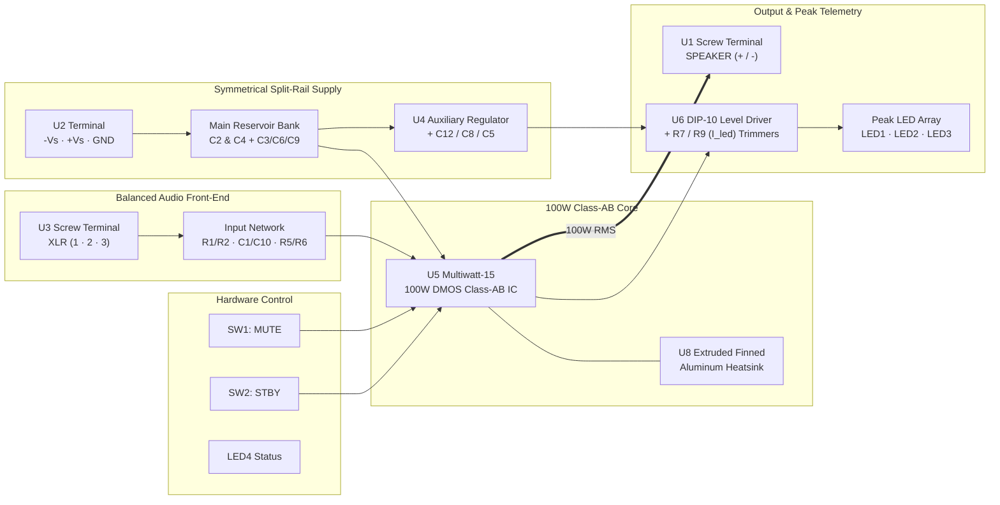

<div align="center">

# AmpAB100 (`ampab-100w`) — 100W Linear Class-AB Audio Power Amplifier

**`90.0 × 75.0 mm` 2-Layer Matte-Black ENIG PCB (`118` Drills) · Multiwatt-15 100W Class-AB Power Stage (`U5`) + Extruded Finned Heatsink (`U8`) · Balanced 3-Pin `XLR` Input · Symmetrical Dual-Rail `±Vs / GND` Supply · `DIP-10` Peak/VU LED Telemetry (`U6`) · Hardware `MUTE` & `STBY` Switches**

[-f59e0b?style=for-the-badge)](PCB/Gerber_AmpAB100/)
[-00ffc3?style=for-the-badge)](model.json)
[-10b981?style=for-the-badge)](model.json)

*Engineered by **MAICXEN EDGE** (`AmpAB Series` — Linear Audio Power Engineering)*

</div>

---

## 1. Overview

**AmpAB100** (`product_id: "ampab"`, `model_id: "ampab-100w"`, `hw_rev: "1.0"`) is the 100W continuous RMS model in the **MAICXEN EDGE `AmpAB Series`** of linear Class-AB audio power amplifiers.

Designed on a **`90.0 × 75.0 mm` 2-layer matte-black ENIG PCB** (`118` PTH/Via drill holes) with chamfered/rounded mounting corners and custom rear **MAICXEN EDGE** acoustic impulse artwork, **AmpAB100** combines a high-current Multiwatt-15 monolithic DMOS Class-AB output stage (`U5`) mounted to an integrated finned heatsink (`U8`) with a balanced 3-pin `XLR` front-end, symmetrical split-rail power filtering (`-Vs / +Vs / GND`), hardware `MUTE` (`SW1`) and `STBY` (`SW2`) controls, and an onboard optical `Peak` level telemetry circuit (`U6`).

> **Ecosystem Archetype (`PCB-Only`)**: Because **AmpAB100** is a pure analog Class-AB power electronics module (`"has_firmware": false, "has_pcb": true`), the ecosystem orchestrator (`scripts/ecosystem_sync.py`) automatically publishes it to the **MAICXEN_site** hardware showcase (`/edge-preview` & `/edge-preview/projects`) while excluding it from the ESP32 Web Flasher and IoT Fleet Console.

---

## 2. Verified Gerber Hardware Architecture (`PCB/Gerber_AmpAB100/`)

All mechanical and electrical specifications below are verified directly from the production RS-274X Gerber and Excellon drill package in [`PCB/Gerber_AmpAB100/`](PCB/Gerber_AmpAB100/):

| Subsystem | Designators | Verified Hardware Implementation |
| :--- | :--- | :--- |
| **PCB Dimensions & Stackup** | `Gerber_BoardOutlineLayer.GKO` | **`90.0 × 75.0 mm`** 2-Layer FR-4 (`GTL`/`GBL`), rounded corners with 4× perimeter mounting holes, `115` PTH component drills + `3` via drills (**`118` total holes**) |
| **100W Class-AB Output Stage** | `U5`, `U8` | 15-pin **Multiwatt-15** high-voltage DMOS Class-AB power amplifier IC (`U5`, TDA7293/TDA7294 architecture) bolted directly to a full-width multi-fin extruded aluminum heatsink (`U8`) along the top edge |
| **Dual-Rail Power Supply & Filtering** | `U2`, `C2`, `C4`, `U4`, `C5`, `C8`, `C12` | 3-way high-current screw terminal block **`U2` (`-Vs`, `+Vs`, `GND`)** feeding primary radial reservoir capacitors (`C2`, `C4`), local HF decoupling (`C3`, `C6`, `C9`), and auxiliary regulator stage (`U4`) |
| **Speaker Output Stage** | `U1` | 2-way heavy-duty screw terminal block **`U1` (`SPEAKER + / -`)** routed with wide low-inductance copper pours from the Multiwatt-15 output pins |
| **Balanced Audio Input Stage** | `U3`, `R1`–`R6`, `C1`, `C7`, `C10` | 3-way screw terminal block **`U3` (`XLR 1 / 2 / 3`)** with precision input conditioning network (`R1`, `R2`, `C1`, `C10`, `R5`, `R6`, `C7`) |
| **Optical Peak & Level Telemetry** | `U6`, `R7`, `R8`, `R9`, `C11`, `LED1`–`LED3` | 10-pin DIP analog logarithmic level/peak detector IC (`U6`), dual multi-turn calibration trimmers (`R7`, `R9` labeled `I_led`), and 3× vertical status/clipping LEDs (`LED1`, `LED2`, `LED3` — **`Peak`**) |
| **Hardware Mute & Standby Control** | `SW1`, `SW2`, `R3`, `R4`, `LED4` | Dedicated slide switches **`SW1` (`MUTE`)** and **`SW2` (`STBY`)** with RC pop-free time constants (`R3`, `R4`, `C5`, `C8`) and status indicator `LED4` |

---

## 3. Signal & Power Flow Topology



---

## 4. Repository Structure

```text
AmpAB100/
├── model.json                      # Declarative lifecycle manifest (deployable: true, hw_rev: 1.0)
├── README.md                       # Hardware architecture & verified Gerber documentation
└── PCB/
    └── Gerber_AmpAB100/            # Production 2-Layer 90.0 × 75.0 mm RS-274X Gerber & Drill package
        ├── Gerber_BoardOutlineLayer.GKO
        ├── Gerber_TopLayer.GTL
        ├── Gerber_BottomLayer.GBL
        ├── Gerber_TopSilkscreenLayer.GTO
        ├── Gerber_BottomSilkscreenLayer.GBO
        ├── Gerber_TopSolderMaskLayer.GTS
        ├── Gerber_BottomSolderMaskLayer.GBS
        ├── Gerber_DocumentLayer.GDL
        ├── Drill_PTH_Through.DRL
        ├── Drill_PTH_Through_Via.DRL
        └── How-to-order-PCB.txt
```

---

<div align="center">

**© 2026 MAICXEN EDGE — All Rights Reserved**  
[EDGE Division Overview (`../../../README.md`)](../../../README.md) · [Workspace Root (`../../../../README.md`)](../../../../README.md)

</div>
